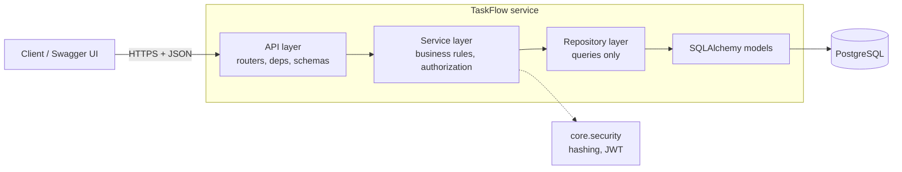

# TaskFlow: Architecture

Team task management REST API built with FastAPI.
This document is the single source of truth for design decisions. Code must follow it; if the code needs to change the design, update this file in the same commit.

---

## 1. Goals and non-goals

### Goals
- A clean, layered, testable REST API.
- Secure by default: authentication, authorization, validation, safe configuration.
- Reproducible environment: Docker Compose locally, CI on every push.
- Small enough to finish and explain line by line.

### Non-goals (for v1)
- No frontend, no real-time features, no file uploads, no email sending.
- No multi-tenancy or organizations. Users share one instance; access is scoped by project membership.
- No microservices. One deployable service, one database.

---

## 2. Tech stack

| Concern | Choice | Why |
|---|---|---|
| Language | Python 3.12+ | Modern typing, wide library support |
| Web framework | FastAPI | Typed, fast, auto OpenAPI docs |
| Validation | Pydantic v2 | Request/response schemas, settings |
| ORM | SQLAlchemy 2.0 (typed `Mapped[]` style, sync) | Mature, explicit, simple to reason about |
| DB driver | psycopg 3 | Current PostgreSQL driver |
| Database | PostgreSQL 16 | Relational integrity, constraints, indexes |
| Migrations | Alembic | Versioned schema changes |
| Password hashing | `pwdlib[argon2]` (Argon2id) | Modern, memory-hard hashing |
| JWT | PyJWT | Maintained, minimal |
| Rate limiting | limits | Protects auth endpoints |
| Testing | pytest, httpx (`TestClient`) | Standard tooling |
| Lint / format / types | Ruff, mypy | Consistent, clean code |
| Container | Docker, Docker Compose | Reproducible runs |
| CI | GitHub Actions | Lint, type-check, test on each push |

Sync SQLAlchemy is a deliberate choice: FastAPI runs `def` endpoints in a thread pool, so it scales fine for this workload and is much simpler to learn, test and debug than async. Moving to async later only touches the repository layer.

---

## 3. High-level architecture



### Layer responsibilities

| Layer | Does | Must NOT |
|---|---|---|
| **API** (`api/`) | Parse requests, call one service method, return response schema, map HTTP details | Contain business rules or SQL |
| **Service** (`services/`) | Business rules, authorization checks, transactions (commit/rollback), orchestration | Know about HTTP (no `Request`, no status codes) |
| **Repository** (`repositories/`) | Build and run queries, return model objects | Commit transactions, make authorization decisions |
| **Models** (`models/`) | Table definitions, relationships, constraints | Contain logic beyond simple helpers |
| **Schemas** (`schemas/`) | Define the exact shape of input and output | Be reused as DB models |
| **Core** (`core/`) | Config, security primitives, exceptions, logging | Import from API/service layers |

**Dependency rule:** imports only point downward: `api -> services -> repositories -> models`. `core` and `db` are importable from anywhere. Nothing imports from `api`.

**Domain exceptions:** services raise domain exceptions (`NotFoundError`, `PermissionDeniedError`, ...). One global handler in `main.py` converts them to HTTP responses. Endpoints contain no `try/except` for business errors.

---

## 4. Project structure

```
taskflow/
├── app/
│   ├── main.py                  # App factory, middleware, exception handlers
│   ├── core/
│   │   ├── config.py            # Settings (pydantic-settings), loaded from env
│   │   ├── security.py          # Password hashing, JWT create/decode
│   │   ├── exceptions.py        # Domain exceptions
│   │   └── logging.py           # Logging setup
│   ├── db/
│   │   ├── base.py              # DeclarativeBase, naming convention, mixins
│   │   └── session.py           # Engine, SessionLocal, get_db dependency
│   ├── models/                  # SQLAlchemy models (one file per entity)
│   │   ├── user.py
│   │   ├── project.py
│   │   ├── project_member.py
│   │   ├── task.py
│   │   └── refresh_token.py
│   ├── schemas/                 # Pydantic schemas (Create / Update / Read)
│   │   ├── common.py            # Page[T], ErrorResponse
│   │   ├── auth.py
│   │   ├── user.py
│   │   ├── project.py
│   │   └── task.py
│   ├── repositories/            # Data access only
│   │   ├── user.py
│   │   ├── project.py
│   │   ├── task.py
│   │   └── refresh_token.py
│   ├── services/                # Business logic
│   │   ├── auth.py
│   │   ├── user.py
│   │   ├── project.py
│   │   └── task.py
│   └── api/
│       ├── deps.py              # get_db, get_current_user, require_admin, service providers
│       └── v1/
│           ├── router.py        # Aggregates all v1 routers
│           └── endpoints/
│               ├── health.py
│               ├── auth.py
│               ├── users.py
│               ├── projects.py
│               └── tasks.py
├── alembic/                     # Migrations
├── alembic.ini
├── tests/
│   ├── conftest.py              # Fixtures: test DB, client, users, tokens
│   ├── unit/                    # Services and security, no DB or HTTP
│   └── integration/             # Full HTTP -> DB tests
├── .github/workflows/ci.yml
├── Dockerfile
├── docker-compose.yml
├── pyproject.toml               # Ruff, mypy, pytest config
├── requirements.txt             # Runtime dependencies (pinned)
├── requirements-dev.txt         # Test and lint dependencies (pinned)
├── .env.example                 # Documented variables, no real secrets
├── .gitignore
├── ARCHITECTURE.md
└── README.md
```

### Naming and style rules
- Files and modules: `snake_case`. Classes: `PascalCase`. Constants: `UPPER_SNAKE`.
- Schemas: `XCreate`, `XUpdate`, `XRead`. Never return a model directly.
- Full type hints everywhere; `mypy --strict` on `app/`.
- One responsibility per function; keep functions short; no hidden global state.
- No business logic in endpoints, no SQL in services.

---

## 5. Domain model

```mermaid
erDiagram
    USERS ||--o{ PROJECT_MEMBERS : "joins"
    PROJECTS ||--o{ PROJECT_MEMBERS : "has"
    PROJECTS ||--o{ TASKS : "contains"
    USERS ||--o{ TASKS : "assigned to"
    USERS ||--o{ TASKS : "created"
    USERS ||--o{ REFRESH_TOKENS : "owns"

    USERS {
        uuid id PK
        string email UK "lowercase, unique"
        string full_name
        string hashed_password
        enum role "admin | member"
        bool is_active
        timestamptz created_at
        timestamptz updated_at
    }
    PROJECTS {
        uuid id PK
        string name
        text description
        uuid owner_id FK
        timestamptz created_at
        timestamptz updated_at
    }
    PROJECT_MEMBERS {
        uuid project_id PK,FK
        uuid user_id PK,FK
        enum role "owner | member"
        timestamptz joined_at
    }
    TASKS {
        uuid id PK
        uuid project_id FK
        string title
        text description
        enum status "todo | in_progress | done"
        enum priority "low | medium | high"
        date due_date
        uuid assignee_id FK "nullable"
        uuid created_by FK
        timestamptz created_at
        timestamptz updated_at
    }
    REFRESH_TOKENS {
        uuid id PK
        uuid user_id FK
        string token_hash UK "SHA-256 of the token"
        uuid family_id "rotation chain"
        timestamptz expires_at
        timestamptz revoked_at "nullable"
        timestamptz created_at
    }
```



### Modeling decisions
- **UUID primary keys** (`uuid4`): non-guessable IDs, which reduces enumeration attacks.
- **Timezone-aware UTC timestamps** everywhere (`TIMESTAMP WITH TIME ZONE`).
- **Email stored lowercase** with a unique index; normalized in the schema validator.
- **Constraints in the database**, not only in code: `NOT NULL`, unique constraints, foreign keys, `CHECK` where useful (e.g. title not empty).
- **Explicit constraint naming convention** in `db/base.py` so Alembic migrations are stable and portable.
- **Enums** are Python `StrEnum` classes stored as native PostgreSQL enums (or `VARCHAR` + `CHECK`, decided once in Step 2 and kept consistent).
- **Deletes:** deleting a project cascades to its members and tasks. Deleting a user is deactivation (`is_active = false`) in v1; hard delete is out of scope.
- **Indexes:** `users(email)`, `project_members(user_id)`, `tasks(project_id, status)`, `tasks(assignee_id)`, `tasks(due_date)`, `refresh_tokens(user_id)`.

---

## 6. Authorization model

Two independent levels:

1. **Global role** (`users.role`): `admin` or `member`.
2. **Project role** (`project_members.role`): `owner` or `member`.

| Action | Admin | Project owner | Project member | Non-member |
|---|:-:|:-:|:-:|:-:|
| Create a project | yes | yes | yes | yes |
| View project and its tasks | yes (all) | yes | yes | no |
| Update / delete project | yes | yes | no | no |
| Add / remove project members | yes | yes | no | no |
| Create task in project | yes | yes | yes | no |
| Update task (any field) | yes | yes | creator or assignee | no |
| Delete task | yes | yes | creator only | no |
| List / deactivate users | yes | no | no | no |

Rules:
- **Authorization is enforced in the service layer**, never only in the router. Every service method that touches project data receives the acting user and checks access first.
- **Object-level checks on every request** (prevents IDOR): a valid ID is not enough; the caller must be allowed to see that object.
- A task assignee must be a member of the task's project.
- **Not-found vs. forbidden:** if a user is not a member of a project, return `404` (do not reveal that the project exists).
- The last owner of a project cannot be removed.

---

## 7. API design

- Base path: `/api/v1`. Versioned from day one.
- JSON only. Resource names are plural nouns. Use correct HTTP verbs and status codes.
- `PATCH` for partial updates (only fields sent are changed). No `PUT` in v1.
- Interactive docs at `/docs` (disabled in production through config).

### Endpoints

| Method | Path | Auth | Description |
|---|---|---|---|
| GET | `/health` | none | Liveness check |
| GET | `/health/ready` | none | Readiness check (verifies DB connection) |
| POST | `/auth/register` | none | Create account |
| POST | `/auth/login` | none | Returns access and refresh tokens |
| POST | `/auth/refresh` | refresh token | Rotates tokens |
| POST | `/auth/logout` | refresh token | Revokes the refresh token family |
| GET | `/users/me` | user | Current user profile |
| PATCH | `/users/me` | user | Update own name |
| GET | `/users` | admin | List users (paginated) |
| PATCH | `/users/{user_id}/deactivate` | admin | Deactivate a user |
| POST | `/projects` | user | Create project (caller becomes owner) |
| GET | `/projects` | user | List projects the caller belongs to (admin: all) |
| GET | `/projects/{project_id}` | member | Project details |
| PATCH | `/projects/{project_id}` | owner/admin | Update project |
| DELETE | `/projects/{project_id}` | owner/admin | Delete project |
| POST | `/projects/{project_id}/members` | owner/admin | Add member |
| DELETE | `/projects/{project_id}/members/{user_id}` | owner/admin | Remove member |
| POST | `/projects/{project_id}/tasks` | member | Create task |
| GET | `/projects/{project_id}/tasks` | member | List tasks with filters |
| GET | `/tasks/{task_id}` | member | Task details |
| PATCH | `/tasks/{task_id}` | see section 6 | Update task |
| DELETE | `/tasks/{task_id}` | see section 6 | Delete task |

### Filtering, sorting, pagination
`GET /projects/{id}/tasks?status=done&priority=high&assignee_id=<uuid>&due_before=2026-12-31&sort=-due_date&page=1&limit=20`

- `limit` default 20, **maximum 100** (enforced).
- `sort` is validated against an allowlist of columns; a leading `-` means descending.
- Response envelope:
```json
{ "items": [ ... ], "total": 42, "page": 1, "limit": 20 }
```

### Error format (one shape for every error)
```json
{
  "error": {
    "code": "task_not_found",
    "message": "Task not found.",
    "details": null
  }
}
```

| Status | When |
|---|---|
| 400 | Business rule violated (e.g. assignee not a project member) |
| 401 | Missing, invalid or expired token |
| 403 | Authenticated but not allowed (e.g. non-admin on admin endpoint) |
| 404 | Not found, or hidden because the caller has no access |
| 409 | Conflict (e.g. email already registered, member already added) |
| 422 | Request validation failed (details list the fields) |
| 429 | Rate limit exceeded |
| 500 | Unexpected error: generic message, full detail only in logs |

---

## 8. Authentication design

### Tokens
| Token | Lifetime | Format | Storage |
|---|---|---|---|
| Access token | 15 minutes | JWT (HS256), claims: `sub`, `role`, `exp`, `iat`, `type=access` | Client only, stateless |
| Refresh token | 7 days | Random 256-bit string (`secrets.token_urlsafe(48)`), **not** a JWT | Client; only its **SHA-256 hash** is stored in the DB |

### Flows
**Register:** validate input, normalize email, hash password with Argon2id, insert user (`409` if the email exists).

**Login:** look up user, verify the password, check `is_active`, issue an access token and a new refresh token (new `family_id`). Wrong email and wrong password return the **same** `401` message and take similar time (no user enumeration).

**Refresh (rotation with reuse detection):**
1. Hash the presented token and find it in the DB.
2. If it is valid and unused: mark it revoked, issue a new refresh token in the same family, and a new access token.
3. If it was **already revoked** (reuse detected): revoke the **whole family** and return `401`. This means a stolen token is neutralized as soon as either party uses it.

**Logout:** revoke the token's family.

**Protected endpoints:** the `get_current_user` dependency decodes the access token (verifying signature, `exp`, and `type=access`), loads the user, and rejects inactive users.

### Password policy
Minimum 12 characters, maximum 128 (prevents hashing DoS); no composition rules (length matters more). Never logged, never returned.

---

## 9. Security checklist (requirements, not suggestions)

**Secrets and configuration**
- All config comes from environment variables via `pydantic-settings`.
- `SECRET_KEY` has **no default**; the app refuses to start without it, and requires at least 32 characters.
- `.env` is git-ignored. `.env.example` documents every variable with fake values.
- Debug features (`/docs`, verbose errors) are toggled by `ENVIRONMENT` and are off in production.

**Input and output**
- Every request body, query and path parameter goes through a Pydantic schema; unknown fields are rejected (`extra="forbid"`).
- Separate Create/Update/Read schemas prevent **mass assignment** (a client can never set `role`, `owner_id`, `id`, etc.).
- Responses use Read schemas, so `hashed_password` can never leak.
- All database access goes through the SQLAlchemy ORM with bound parameters; **no string-built SQL**.
- Length limits on every string field; sort fields allowlisted; pagination capped.

**Access control**
- Object-level authorization on every resource access (see section 6).
- Admin-only endpoints use a dedicated `require_admin` dependency.

**Abuse protection**
- Rate limits: strict on `/auth/login`, `/auth/register`, `/auth/refresh` (e.g. 5-10 per minute per IP), looser defaults elsewhere.
- Request body size limit.
- CORS: an explicit allowlist from config, never `*` together with credentials.

**Transport and headers**
- HTTPS is terminated at the hosting platform; the app trusts proxy headers only from configured proxies.
- Security headers middleware: `X-Content-Type-Options: nosniff`, `X-Frame-Options: DENY`, `Referrer-Policy: no-referrer`, `Strict-Transport-Security` in production.

**Logging and errors**
- Structured logs with a request ID. **Never log** passwords, tokens or full request bodies.
- Unhandled exceptions return a generic `500`; stack traces stay in server logs only.

**Supply chain and containers**
- Dependencies pinned; `pip-audit` runs in CI; Dependabot enabled.
- Docker image: slim base, **non-root user**, no secrets baked into the image, multi-stage build, `.dockerignore`.

---

## 10. Database and migrations

- One Alembic migration per logical change; migrations are committed and reviewed.
- Migrations run explicitly (`alembic upgrade head`), never automatically on app start in production.
- Session handling: one session per request via the `get_db` dependency. **Services own the transaction**: commit on success, rollback on any exception. Repositories never commit.
- Connection pool configured via settings; `pool_pre_ping=True`.
- Environments: `development` (Compose Postgres), `test` (separate database, schema created per test session, each test wrapped in a rolled-back transaction), `production` (managed Postgres).

---

## 11. Configuration

Variables (documented in `.env.example`):

| Variable | Purpose | Example |
|---|---|---|
| `ENVIRONMENT` | `development` / `test` / `production` | `development` |
| `DATABASE_URL` | SQLAlchemy URL | `postgresql+psycopg://user:pass@db:5432/taskflow` |
| `SECRET_KEY` | JWT signing key (required, 32+ chars) | generated |
| `ACCESS_TOKEN_EXPIRE_MINUTES` | Access token lifetime | `15` |
| `REFRESH_TOKEN_EXPIRE_DAYS` | Refresh token lifetime | `7` |
| `CORS_ORIGINS` | Comma-separated allowlist | `http://localhost:3000` |
| `RATE_LIMIT_AUTH` | Auth endpoint limit | `5/minute` |
| `LOG_LEVEL` | Logging level | `INFO` |

Settings are loaded once into a typed `Settings` object and injected through a cached `get_settings()` dependency.

---

## 12. Testing strategy

| Type | Scope | Tools |
|---|---|---|
| Unit | Security helpers, service rules with fake repositories | pytest |
| Integration | HTTP -> service -> repository -> real PostgreSQL | pytest, `TestClient` |

Must-have test cases:
- Register, login, wrong password, duplicate email, inactive user.
- Token expiry, tampered token, refresh rotation, **refresh reuse detection**.
- Authorization matrix from section 6, including **IDOR attempts** (user B accessing user A's project or task returns `404`).
- Task CRUD, filters, sorting allowlist, pagination limits.
- Validation errors return the standard error shape.

Quality gates in CI: `ruff check`, `ruff format --check`, `mypy`, `pytest` with coverage (target 80%+), `pip-audit`.

---

## 13. Deployment and CI/CD

**Local:** `docker compose up` starts the API and PostgreSQL. A separate command runs migrations.

**Dockerfile:** multi-stage, slim Python image, non-root user, runs `uvicorn` with no `--reload`.

**CI (`.github/workflows/ci.yml`)** on every push and pull request:
1. Set up Python, install dependencies (cached).
2. Ruff lint and format check.
3. mypy.
4. Start a PostgreSQL service container, run migrations, run pytest with coverage.
5. `pip-audit`.
6. (Main branch) build the Docker image.

**Hosting:** Render or Railway with a managed PostgreSQL; environment variables set in the platform dashboard; a `/health/ready` check configured as the health probe.

---

## 14. Build order (roadmap)

1. **Step 1: Skeleton.** FastAPI app, `/health`, git. *(done)*
2. **Step 2: Foundation.** `core/config`, `db/session`, `db/base`, Docker Compose Postgres, Alembic setup, `User` model and first migration.
3. **Step 3: Auth.** Security helpers, register/login/refresh/logout, `get_current_user`, `/users/me`.
4. **Step 4: Projects.** Models, repository, service, endpoints, membership rules.
5. **Step 5: Tasks.** CRUD, filters, sorting, pagination, authorization matrix.
6. **Step 6: Hardening.** Global error handling, rate limiting, security headers, logging, request IDs.
7. **Step 7: Tests.** Unit and integration tests to the coverage target.
8. **Step 8: DevOps.** Dockerfile, CI workflow, deployment, final README with screenshots of `/docs`.

Each step ends with a working app and a commit. No step starts before the previous one passes its checks.

---

## 15. Definition of done (per feature)

- Follows the layer rules in section 3.
- Has request and response schemas; no model leaks.
- Authorization enforced in the service layer.
- Tests written and passing; Ruff and mypy clean.
- Migration included if the schema changed.
- This document updated if the design changed.
